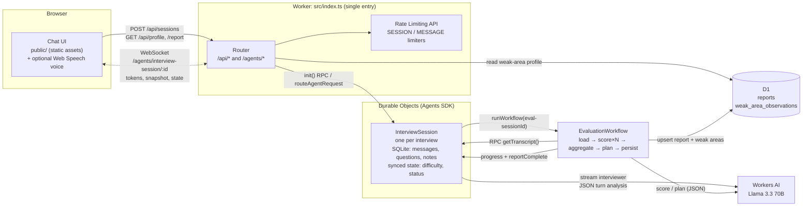

# MockLoop: an AI mock-interview coach on Cloudflare

MockLoop runs realistic mock interviews. You pick a **target role**, a
**seniority** and an **interview type** (behavioral, technical or system
design). An AI interviewer then asks **one question at a time**, probes your
answers with follow-ups, and adapts difficulty as you go. When you finish, a
background **Cloudflare Workflow** scores every answer against a rubric and
writes a report with an improvement plan. MockLoop **remembers your recurring
weak areas** across sessions and steers the next interview toward them.

Everything runs on Cloudflare: Workers, Workers AI (Llama 3.3 70B), Durable
Objects through the Agents SDK, Workflows, D1, the Rate Limiting API and
static assets.

> Docs: [`docs/PROJECT_DOCS.md`](docs/PROJECT_DOCS.md) is the end-to-end
> explainer (overview, design decisions, glossary, Q&A).
> [`PROMPTS.md`](PROMPTS.md) lists every AI prompt.

---

## How the four required components map to the code

| Component                     | Implementation                                                                                                                                                                                                                                                                                                                                                            |
| ----------------------------- | ------------------------------------------------------------------------------------------------------------------------------------------------------------------------------------------------------------------------------------------------------------------------------------------------------------------------------------------------------------------------- |
| **LLM**                       | Llama 3.3 70B on Workers AI (`@cf/meta/llama-3.3-70b-instruct-fp8-fast`). Interviewer messages are **streamed** token by token to the browser. Scoring, turn analysis and plans use **JSON mode + zod validation + one repair retry** (`src/llm/json.ts`). Prompts are versioned files in `src/prompts/`.                                                                 |
| **Workflow / coordination**   | **Durable Objects** (`agents` SDK) coordinate each live session: one object per interview serialises every turn (`src/session/InterviewSession.ts`). A **Cloudflare Workflow** runs the evaluation as durable, retryable, idempotent steps: `load-transcript → score-answer-1..N → aggregate → improvement-plan → persist-report` (`src/workflow/EvaluationWorkflow.ts`). |
| **User input (chat + voice)** | Chat UI served as **Worker static assets** (`public/`), over a **WebSocket** with streaming tokens. Optional voice uses the browser Web Speech API (dictation + read-aloud). It is feature-detected and hidden where unsupported.                                                                                                                                         |
| **Memory / state**            | **Per-session state** lives in the session Durable Object's SQLite storage: role, difficulty, questions (with follow-up tree), transcript, running notes. **Long-term memory** lives in **D1**: finished reports plus a per-user weak-area profile, which the next session's interviewer prompt reads (`src/memory/profile.ts`).                                          |

---

## Architecture



### One interview, end to end

```mermaid
sequenceDiagram
    autonumber
    participant B as Browser
    participant W as Worker
    participant S as InterviewSession DO
    participant AI as Workers AI
    participant WF as EvaluationWorkflow
    participant D1 as D1

    B->>W: POST /api/sessions {role, seniority, type}
    W->>D1: read recurring weak areas for this user
    W->>S: init({config, focusAreas})
    W-->>B: {sessionId}
    B->>S: WebSocket connect
    S-->>B: snapshot (full transcript) + synced state
    S->>AI: interviewer prompt (stream)
    AI-->>S: tokens
    S-->>B: message_start / token… / message_end
    loop each answer
        B->>S: {type: "answer", text}
        S->>S: validate length, turn cap, rate limit; store answer
        S->>AI: turn-analysis (JSON) → note, follow-up?, difficulty Δ
        S->>S: deterministic guards → plan
        S->>AI: interviewer prompt with plan (stream)
        S-->>B: streamed question
    end
    B->>S: {type: "end"} (or turn cap reached)
    S-->>B: streamed closing message
    S->>WF: runWorkflow(id = eval-sessionId)
    WF->>S: getTranscript()
    WF->>AI: score answer 1..N (one step each)
    WF->>WF: aggregate against rubric
    WF->>AI: improvement plan (JSON)
    WF->>D1: upsert report + weak areas (one transaction)
    WF->>S: reportComplete → state.status = done
    S-->>B: state sync → UI shows report
```

### Repository layout

```
├─ wrangler.jsonc                 # every binding: AI, DO, Workflow, D1, rate limiters, assets, vars
├─ migrations/0001_init.sql       # D1 schema (checked in)
├─ public/                        # chat UI (static assets): index.html, styles.css, app.js (// @ts-check)
├─ src/
│  ├─ index.ts                    # single Worker entry + routing; exports DO + Workflow classes
│  ├─ domain.ts                   # shared types + zod schemas for trust boundaries
│  ├─ limits.ts                   # input caps, turn cap, rate-limit helper
│  ├─ session/
│  │  ├─ InterviewSession.ts      # Agent (Durable Object): live interview, streaming, resume
│  │  ├─ protocol.ts              # typed WebSocket protocol
│  │  └─ turn.ts                  # deterministic guards around the model's turn proposal
│  ├─ workflow/EvaluationWorkflow.ts
│  ├─ evaluation/steps.ts         # scoreExchange / writeImprovementPlan (shared by Workflow + eval script)
│  ├─ llm/client.ts               # LlmClient over the AI binding; SSE stream parser
│  ├─ llm/json.ts                 # JSON mode + zod validation + one repair retry
│  ├─ prompts/                    # versioned prompts: interviewer, turn-analysis, score-answer, improvement-plan, json-repair
│  ├─ rubric/                     # rubrics per interview type + pure aggregation
│  └─ memory/profile.ts           # D1: reports, weak-area profile (idempotent upserts)
├─ test/
│  ├─ unit/                       # prompts, aggregation, JSON repair, SSE parsing, turn guards
│  ├─ integration/                # session DO over real WebSockets; Workflow end to end
│  └─ fixtures/fake-ai.mjs        # scripted Workers AI stand-in (RPC service binding)
├─ scripts/
│  ├─ eval-scorer.ts              # scorer ordering + stability eval against the real model
│  ├─ eval-cases.ts               # 12 canned answers (4 questions × weak/average/strong)
│  └─ render-prompts.ts           # prints every rendered prompt (used for PROMPTS.md)
├─ PROMPTS.md
└─ docs/PROJECT_DOCS.md
```

---

## Run it locally

### Prerequisites

- **Node.js 20+** (developed on Node 22) and npm
- A **Cloudflare account**. The free plan is enough to try it, within the
  daily Workers AI allocation. Workers AI has no local
  emulator, so the `AI` binding always runs remotely, even under
  `wrangler dev`. Everything else (Durable Objects, Workflows, D1, rate
  limiting, assets) runs locally.

### Steps

```bash
# 1. Install dependencies
npm install

# 2. Log in to Cloudflare (needed for the remote Workers AI binding)
npx wrangler login

# 3. Create the local D1 database schema
npm run db:migrate:local        # = wrangler d1 migrations apply mockloop --local

# 4. Start the dev server (Worker + DO + Workflow + D1 locally, Workers AI remotely)
npm run dev                     # = wrangler dev
# open http://localhost:8787
```

Without step 2, `wrangler dev` stops at startup with "Failed to start the
remote proxy session". The tests below do **not** need a login.

### Tests, types, lint

```bash
npm test               # vitest inside workerd via @cloudflare/vitest-pool-workers (no network, AI is faked)
npm run typecheck      # tsc --strict for the Worker + checkJs for the browser client
npm run lint           # eslint (typescript-eslint strictTypeChecked)
npm run format:check   # prettier
```

### Scorer eval (real model)

```bash
cp .dev.vars.example .dev.vars   # fill CLOUDFLARE_ACCOUNT_ID + an API token with "Workers AI: Read"
npm run eval                     # default 3 runs per answer; npm run eval -- --runs 5
```

This writes a JSON report to `eval-results/` (git-ignored). See
[Scorer eval results](#scorer-eval-results) below.

---

## Deploy (run these yourself)

This repo has **not** been deployed. To deploy it to your own account:

```bash
# 1. Log in
npx wrangler login

# 2. Create the D1 database, then paste the printed database_id into
#    wrangler.jsonc → d1_databases[0].database_id (replacing the all-zero placeholder)
npx wrangler d1 create mockloop

# 3. Apply migrations to the remote database
npm run db:migrate:remote       # = wrangler d1 migrations apply mockloop --remote

# 4. Deploy the Worker, Durable Object class, Workflow and static assets in one go
npx wrangler deploy

# 5. Open the printed https://cf-ai-mockloop.<your-subdomain>.workers.dev URL
#    Tail logs while you try it:
npx wrangler tail
```

Notes:

- The Durable Object migration (`new_sqlite_classes`) and the Workflow are
  created by `wrangler deploy`. No dashboard steps are needed.
- `ratelimits[].namespace_id` values (`41001`, `41002`) are arbitrary
  integers that must be unique within your account. Change them if they
  collide.
- Workers AI is billed in neurons beyond a daily free allocation. One
  interview with N answers makes 2N + 2 model calls live (opening, plus
  analysis + question per answer, plus closing) and N + 1 for the
  evaluation, plus any repair calls.

---

## Testing strategy

**68 tests** run inside the real Workers runtime (workerd) through
`@cloudflare/vitest-pool-workers`. They use the real `wrangler.jsonc`
bindings with one substitution: the remote `AI` binding is replaced by a
scripted fake (`test/fixtures/fake-ai.mjs`, bound as an RPC service
binding). Production code has no "test mode" branch.

| Suite                          | What it proves                                                                                                                                                                                                                                                                                                                                                                                                                                                         |
| ------------------------------ | ---------------------------------------------------------------------------------------------------------------------------------------------------------------------------------------------------------------------------------------------------------------------------------------------------------------------------------------------------------------------------------------------------------------------------------------------------------------------- |
| `unit/prompts.test.ts`         | Prompt assembly: role, seniority and difficulty in the system prompt; memory injection only when present; one distinct instruction per plan; history windowing and role mapping; prompt-injection fencing; scorer and plan schemas restricted to rubric dimensions; prompt version registry.                                                                                                                                                                           |
| `unit/aggregate.test.ts`       | Rubric weights sum to 1; weighted averaging; null (not-applicable) handling with weight renormalisation; clamping; weak-area ordering + evidence; empty input rejected.                                                                                                                                                                                                                                                                                                |
| `unit/json.test.ts`            | JSON extraction from fences/prose/truncation; zod error reporting; generateJson: first-try success (no repair), one repair with the original context, failure after exactly one repair, transport errors propagate without repair.                                                                                                                                                                                                                                     |
| `unit/stream.test.ts`          | SSE parsing across chunk boundaries, `[DONE]`, OpenAI-style deltas, keep-alives.                                                                                                                                                                                                                                                                                                                                                                                       |
| `unit/turn.test.ts`            | Deterministic guards: follow-up depth limit, turn cap, difficulty clamping, fallback when analysis fails.                                                                                                                                                                                                                                                                                                                                                              |
| `integration/session.test.ts`  | Over real WebSockets: token streaming; difficulty adaptation; follow-up question tree in DO SQLite; **reconnect returns full ordered history**; streamed text = stored text; **failed stream → interrupted → retry without duplicates**; LLM failure in turn analysis doesn't stall the interview; length limits; malformed frames; **clients can't write server-owned state**; turn cap; rate limiting; ownership (4403) and unknown sessions (4404); API validation. |
| `integration/workflow.test.ts` | Full pipeline: DO → Workflow → D1 → callback to DO → **next session is seeded with the weak areas** (memory loop); malformed scorer output repaired inside a step; a step failing twice then succeeding; a permanently failing step surfaces as a retryable `failed` state; the persist step is idempotent.                                                                                                                                                            |

### Scorer eval results

> **Not yet run.** The eval needs a Cloudflare API token (see above). Results
> will be recorded here verbatim once it has been run against the real model.

---

## Design decisions and known shortcuts

These shortcuts are deliberate. Each is listed with its trade-off.

1. **No real authentication.** The browser generates an anonymous UUID
   (`localStorage`) and sends it as `x-mockloop-user`. The session DO
   rejects WebSocket connections whose `uid` doesn't match. Session ids are
   unguessable UUIDs, and reports are only returned to their owner. The
   trade-off: anyone holding a user's id could read that user's profile.
   Production would put **Cloudflare Access** or a real login in front and
   derive the user id from a verified JWT.
2. **Two LLM calls per turn** (a small JSON turn-analysis, then the streamed
   question). This adds latency before the first token, but adaptation
   becomes explicit, stored and testable, and code enforces the limits. The
   alternative was to hide control tokens inside the streamed reply, which
   is fragile and hard to test.
3. **Vanilla JS UI** (no React/Vite build). There are fewer moving parts and
   it's type-checked with `// @ts-check`. The trade-off is that it doesn't
   use the `agents` React hooks. The client speaks the Agents SDK protocol
   directly (`cf_agent_state` frames).
4. **The eval uses the Workers AI REST API** rather than the binding. It
   calls the exact same scoring function, prompt and validator
   (`src/evaluation/steps.ts`), but needs an API token in your shell.
5. **Rate limiting is per location and eventually consistent** (Workers Rate
   Limiting API). That's right for abuse control, but it is not a billing
   quota.
6. **No session expiry yet.** Durable Object storage for abandoned sessions
   persists. The next step is a `this.schedule()` cleanup some days after
   the last activity.
7. **Voice depends on the browser.** Dictation needs the Web Speech
   recognition API (Chrome/Edge/Safari), and read-aloud uses
   `speechSynthesis`. Both are hidden when unsupported, and text is always
   the primary path.

## Next steps

- Cloudflare Access (or OAuth) for identity, with the user id taken from a
  verified JWT.
- AI Gateway in front of Workers AI for caching, analytics, rate limits and
  model fallback.
- A smaller, faster model for turn analysis to cut first-token latency, with
  the 70B model kept for the interviewer and scoring.
- Session expiry with `this.schedule()`; a report history view and progress
  charts per dimension.
- Workers AI speech models (Whisper / MeloTTS) for consistent voice across
  browsers.
